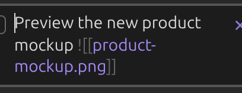
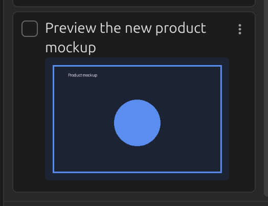
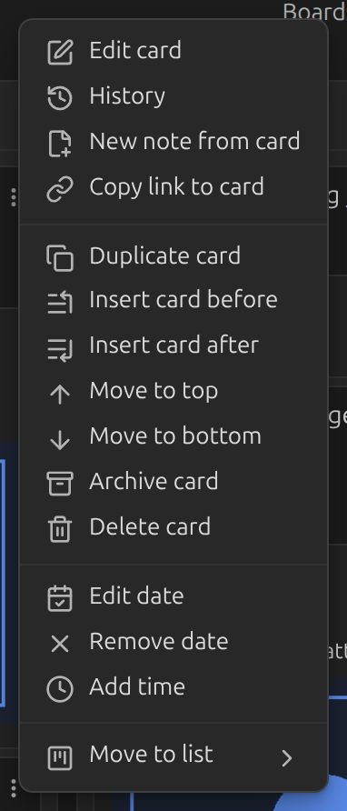
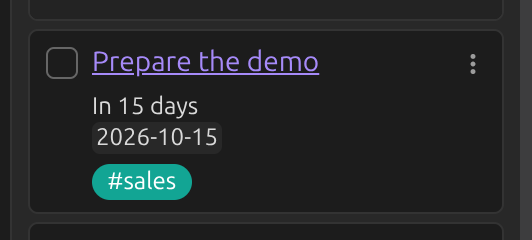
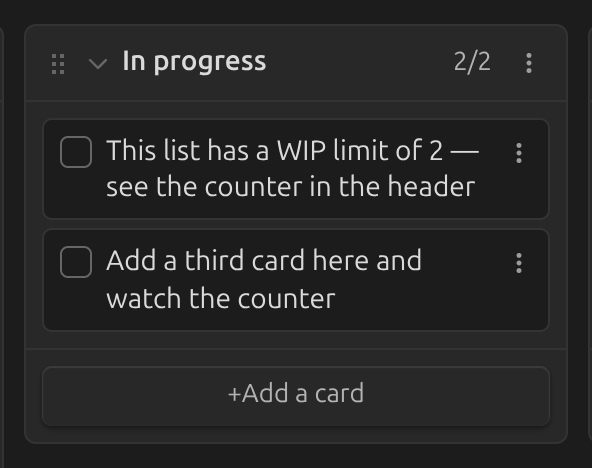
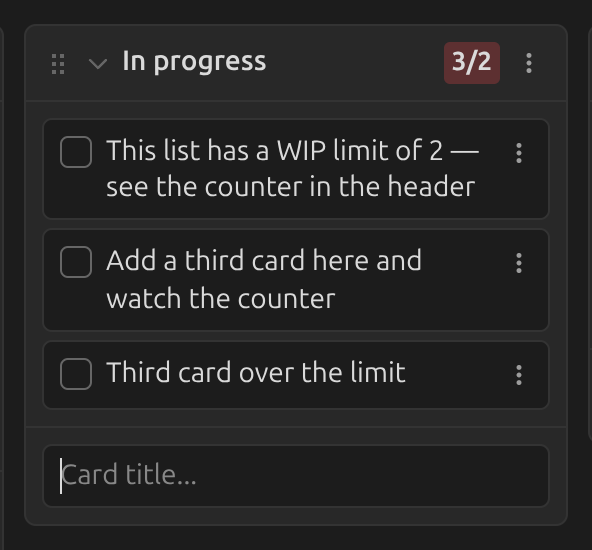
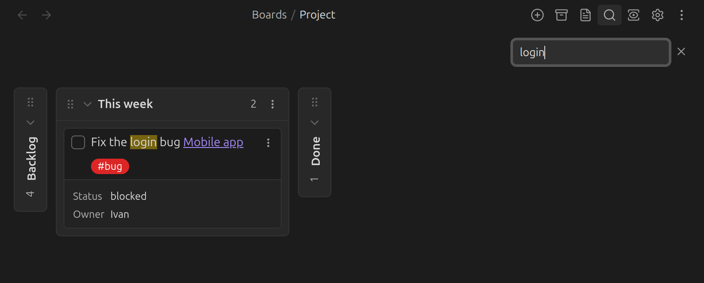

# Cards and lists

## Adding and editing cards

Click **Add a card** at the bottom (or top, depending on your
[insertion setting](../settings/general.md#prepend-append-new-cards)) of a list, or click a
card to edit it in place. By default, `Enter` finishes a card and `Shift+Enter` adds a new line
— this can be swapped in [New line trigger](../settings/general.md#new-line-trigger).

Turn on a checkbox next to each card's title with
[Display card checkbox](../settings/general.md#display-card-checkbox); `Ctrl`/`Cmd`-clicking it
archives the card.

## Quick actions

Hover a card to show its quick action panel in the top-right corner: by default **Mark as
done**, **Add or change date**, **Move to next list** and `⋮`, which opens the card menu (as
does a right-click). Choose the buttons in [Quick actions](../settings/quick-actions.md).

## Card size

Set a card's size from its menu (**Size**), or click the size in the card footer to change it:
**XS**, **S**, **M**, **L** or **XL**. Each list shows the total of its sizes next to the card
count; hover it, or click it, to see how it adds up. The size is a tag in the card text
(`#size/M`); see [Card size](../settings/card-size.md). To set sizes in one click, add **Set
size** to the [quick actions](../settings/quick-actions.md).

## Card relations

Link two cards of the same board: right-click a card → **Add relation**, pick the kind of
relation, then pick the other card. The kinds read from both sides:

| On this card | On the other card |
|---|---|
| Blocks | Blocked by |
| Relates to | Relates to |
| Duplicates | Duplicated by |
| Causes | Caused by |
| Depends on | Required for |

A card blocked by a card that is not done yet shows a red **Blocked** mark above its text and a
dashed checkbox; once the blocking card is done or archived, the mark goes away. It is only a
signal: a blocked card can still be moved and checked.

The footer shows how many relations a card has. Click the number (or **Blocked**) to see them:
click a card there to scroll the board to it, `×` to remove the relation, **Add relation** to add
another. Relations to archived cards stay in the list, marked *in archive*. Deleting a card
removes its relations; a duplicated card has none.

Relations are kept in a hidden block at the end of the board file, so the card text does not
change. See [Card relations](../settings/card-relations.md) to switch them off, and add **Add
relation** to the [quick actions](../settings/quick-actions.md) to relate cards in one click.

## Epics

An epic is a card that groups other cards of the board, for example a feature and its tasks.
Right-click a card → **Epic** → **Make epic**. To add a card to it, right-click that card →
**Epic** → **Add to epic** and pick the epic, or right-click the epic → **Epic** → **Add cards
to epic** and pick the card.

Each card of an epic shows the epic's name and colour above its text. The epic card has a band
of its colour at the top, **Epic** above its text, and its progress at the bottom: a bar, how
many of its cards are done (`3 / 5`) and, for cards with a [size](../settings/card-size.md), how
much of the total weight is done (`8 / 13`). A card counts as done when it is checked or in the
archive. Hover the progress for the breakdown by size.

Click the progress (or **Epic**) to see the epic's cards: click one to scroll the board to it,
`×` to take it out of the epic, **Add cards to epic** to add more. There you also pick the
epic's colour and **Remove epic** (its cards stay, they just belong to no epic). Click the epic's
name on one of its cards to jump to the epic, move the card to another epic or take it out.

A card belongs to one epic at most: adding it to another epic moves it. An epic has no size of
its own — making a card with a size an epic removes its size — and the list's size total does not
count epics, only their cards. Deleting an epic card removes the epic; a duplicated card is in
no epic.

Epics are kept in a hidden block at the end of the board file, so the card text does not change.
See [Epics](../settings/epics.md) to switch them off, and add **Epic** to the
[quick actions](../settings/quick-actions.md) to reach these actions in one click.

## Embedding images

Images can be embedded in a card just like in any other Obsidian note:




A card can also *display* an image pulled from a linked note's metadata — see
[Linked page metadata](linked-page-metadata.md#displaying-images).

## Creating a note from a card

Right-click a card, or open its `⋮` menu (in the [quick action panel](#quick-actions)), and
choose **New note from card**.



This creates a note in the [note folder](../settings/general.md#note-folder) using the
[note template](../settings/general.md#note-template), titled after the card's text. The card
then links to the new note.



## List descriptions

A list can have a short description under its title — what belongs in it, who works on it, a
link to a related note. It is shown in a smaller, muted font so it does not draw attention
away from the cards. Lists without a description look as before.

- To add one, open the list menu (**⋮**) and choose **Add description**, or fill in the
  optional *Description* field when creating a list.
- To change it, double-click the description (or use **Edit description** in the list menu).
  As with cards, **Enter** saves and **Shift+Enter** adds a new line (see
  [New line trigger](../settings/general.md#new-line-trigger)); **Esc** cancels and clicking
  elsewhere saves. Clear the text to remove the description.

The description may span several lines and use markdown: links, `[[wikilinks]]`, bold and
italic. In the board file it is the text right under the list's heading:

```markdown
## In progress (3)

Work for this week. See [[Roadmap]].

- [ ] A card
```

## WIP limits

To cap how many cards a list can hold, put the limit in parentheses after the list's title —
for example, rename **In progress** to `In progress (5)`. The limit shows next to the list's
card count:



Once the list has more cards than the limit, the count is shown in bold:



Rename the list again with a new number (or without one) to change or remove the limit.

## Searching a board

Search a board like any other note — the default hotkey is `Ctrl`/`Cmd` + `F`.



Whether clicking a tag searches the board or the whole vault is controlled by
[Tag click action](../settings/tags.md#tag-click-action).

## Filtering by tags and boards

The funnel button in the board header opens a filter row under it:

- **Tags.** Click the field to see every tag on the board with the number of its cards, or
  type to narrow the list. Pick as many as you like: the board shows cards that have *any*
  of the selected tags. Picking `#work` also shows `#work/urgent`; case does not matter.
- **Boards.** On a board with [linked lists](linked-lists.md), a second field picks the
  boards whose cards to show (*This board* is the board you are looking at).

Selected tags and boards appear as chips; click × on a chip to remove it, or press
Backspace in an empty field. Lists without matching cards collapse while the filter is on,
and the filter works together with the text search. As with search, *Add a card* is hidden
while the filter is on — a new card without the selected tags would disappear at once.

Click the funnel again (or × at the end of the row) to close the row and reset the filter.
The filter is never saved to the board file and resets when the tab is closed. On phones,
where the header buttons are hidden, use the command **Filter cards by tag**.

The button can be hidden in [Board header buttons](../settings/board-header-buttons.md).
