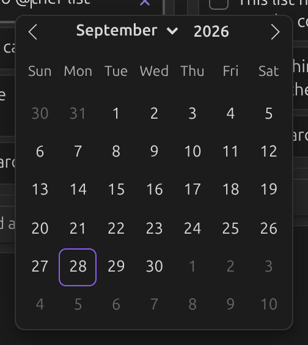
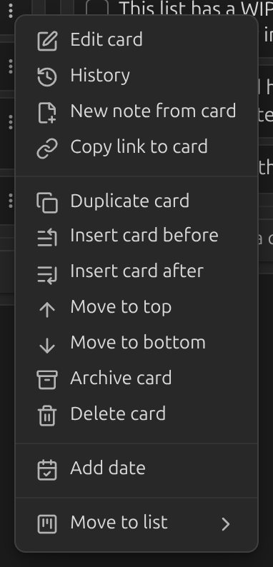
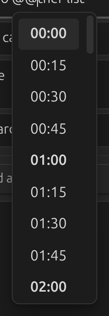
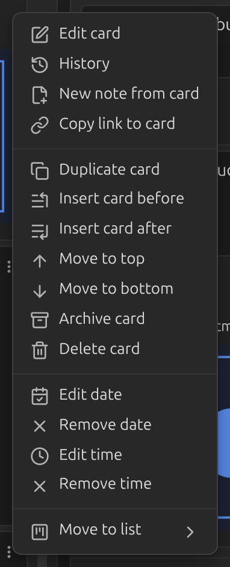

# Dates and times

## Adding a date

Type the [date trigger](../settings/dates-and-time.md#date-trigger) — `@` by default — while
editing a card to open the date picker.



You can also right-click a card, or open its `⋮` menu, and choose **Add date**.



## Adding a time

Type the [time trigger](../settings/dates-and-time.md#time-trigger) — `@@` by default — to open
the time picker.



A card that already has a date can also get a time from its `⋮` menu.



## Dates as tags

If you already mark notes with date tags, switch [Date syntax](../settings/dates-and-time.md#date-syntax)
to **Tag**. A card's date is then written as an ordinary Obsidian tag:

| Tag | Meaning |
|---|---|
| `#26-10-14` | 14 October 2026, no time |
| `#26-10-14-13-25-20` | 14 October 2026, 13:25:20 |
| `#26-10-14-00-00-00` | 14 October 2026, midnight |

The tags show up in Obsidian's tag pane and search like any other tag. On the card they look
and work like any other date: colours, sorting, search, the calendar on click. The date
trigger writes the tag, and the time trigger adds the time to the card's date tag (or to
today's date if the card has none). If a card has several date tags, the first one is its date.

Only one syntax works at a time. With **Tag**, `@{…}` dates are plain text, and with the
default syntax, date tags are ordinary tags. Switching does not change your files.

By default the card shows the date and time in your display formats (`#26-10-14` and
`13:25`). Turn on [Show date tags as written](../settings/dates-and-time.md#show-date-tags-as-written)
to show the tag itself, `#26-10-14-13-25-20`. It is then a real Obsidian tag, so CSS snippets
for tags apply to it (for example `a.tag[href^="#26-10"]`), and it keeps the date colours.
Clicking it still opens the calendar; the time is changed from the card menu.

## Hiding dates and tags on cards

There is no setting for this; a [CSS snippet](https://help.obsidian.md/snippets) does it.
The date or tags stay in the card's markdown and keep working (colours, sorting, search,
filters), and you still see them while editing the card or in the card menu.

```css
/* Hide card dates: in the card text, in the footer, and the relative date */
.kanban-starlane__item-markdown .kanban-starlane__date,
.kanban-starlane__item-metadata-date-wrapper,
.kanban-starlane__item-metadata-date-relative {
  display: none !important;
}

/* Hide tags: in the card text and in the footer */
.kanban-starlane__item-markdown a.tag,
.kanban-starlane__item-tags {
  display: none !important;
}
```

Keep only the part you need. With [Show date tags as written](../settings/dates-and-time.md#show-date-tags-as-written)
on, the card's date is a tag too, so the second rule hides it as well; to keep it, write the
first selector as `.kanban-starlane__item-markdown a.tag:not(.kanban-starlane__date-tag > a.tag)`. To hide the dates on one board only, add a
[`cssclasses`](https://help.obsidian.md/Editing+and+formatting/Properties#Default+properties)
property to the board note (say `cssclasses: hide-dates`) and put `.hide-dates` in front of
each selector: `.hide-dates .kanban-starlane__item-markdown .kanban-starlane__date`.

## Formatting and display

- [Date format](../settings/dates-and-time.md#date-format) and
  [Time format](../settings/dates-and-time.md#time-format) control what gets written into the
  card's markdown.
- [Date display format](../settings/dates-and-time.md#date-display-format) controls how the
  date is shown on the card, independently of what's saved to disk.
- Move the date out of the card's body and into its footer with
  [Move dates to card footer](../settings/dates-and-time.md#move-dates-to-card-footer).
- Turn on [Show relative date](../settings/dates-and-time.md#show-relative-date) to show "in 3
  days" or "a month ago" instead of a fixed date.
- Turn on [Link dates to daily notes](../settings/dates-and-time.md#link-dates-to-daily-notes)
  to make a card's date open the matching daily note.
