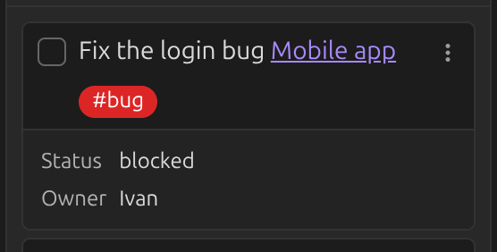
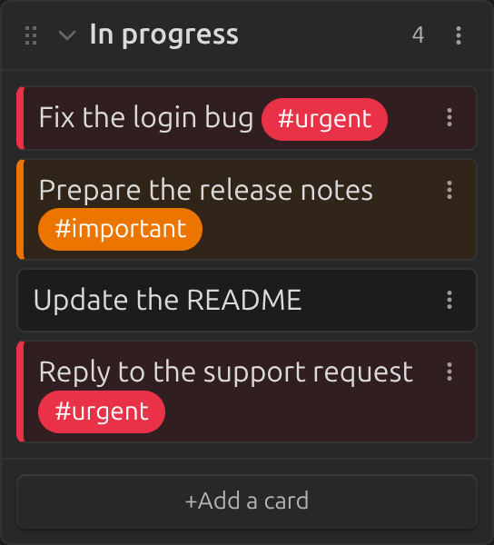
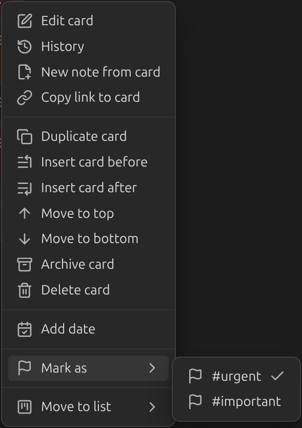

# Tags

Write `#tags` anywhere in a card's text and they're picked up like anywhere else in Obsidian —
they show up in Obsidian's tag search and pane too.

By default, tags stay in the card's body and clicking one searches the whole vault. You can:

- Move tags to the card's footer instead of the body —
  [Move tags to card footer](../settings/tags.md#move-tags-to-card-footer).
- Show only the cards with some tags — the
  [filter](cards-and-lists.md#filtering-by-tags-and-boards) in the board header.
- Make clicking a tag filter the board instead of searching the vault —
  [Tag click action](../settings/tags.md#tag-click-action).
- Give specific tags a color, or control how lists are sorted by tag —
  see [Tags settings](../settings/tags.md).

## Highlighting important cards

Cards tagged `#urgent` or `#important` stand out on the board with a colored stripe and tint.
Type the tag in the card, or open the card menu (**⋮**) → **Mark as** and pick `#urgent` or
`#important`. A checkmark shows the marks a card already has; pick one again to take it off.

Both tags come ready in [Tag colors](../settings/tags.md#tag-colors). Any other tag can
highlight cards the same way — switch on [Highlight card](../settings/tags.md#highlight-card)
for it.
