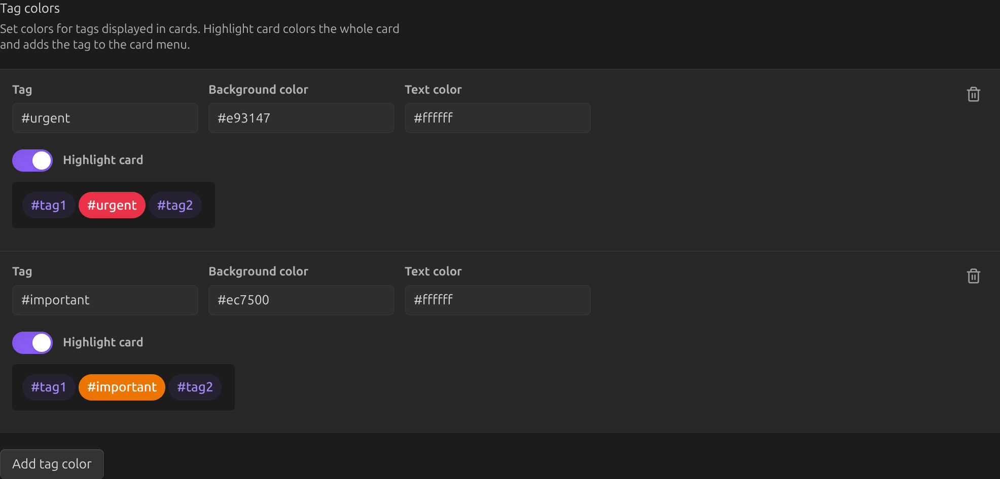

# Tags

## Move tags to card footer

When on, tags are shown in the card's footer instead of inline in its body text.

## Tag click action

Controls what clicking a tag on a card does:

- **Search Obsidian Vault** (default) — opens Obsidian's global search for that tag.
- **Search Kanban Board** — filters the current board by that tag instead (adds it to the
  [filter](../guide/cards-and-lists.md#filtering-by-tags-and-boards); with the **Filter**
  header button turned off, it searches the board's text).

## Tag sort

Controls the order lists sort cards into when a tag-based sort is used. Add tags in the order
you want them to sort; cards without a listed tag sort after the ones that have one.

## Tag colors

Give specific tags a background and text color, shown wherever that tag appears on a card.

### Highlight card

Switch on **Highlight card** for a tag to mark the whole card, not only the tag: cards with
that tag get a stripe on the left and a light tint of the tag's background color (or its text
color, if only that is set).

A new install comes with two such tags ready: `#urgent` (red) and `#important` (orange). Change
their colors, switch the highlight off or delete them like any other entry. An update from an
earlier version does not add them, so cards you already tagged `#urgent` don't change by
themselves.

Every tag with **Highlight card** on also appears in the card menu (**⋮**): **Add tag #urgent**
adds the tag to the card, **Remove tag #urgent** takes it away.

- If a card has several highlighting tags, the first one in the *Tag colors* list wins; to
  change the order, remove an entry and add it again.
- The highlight shows on the board, not in the table view.
- Tag colors set in a board's own settings replace the global list for that board, the
  ready-made tags included.
